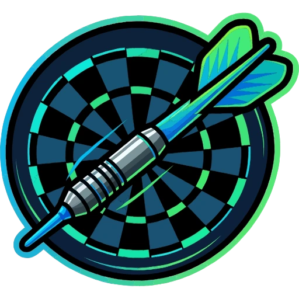
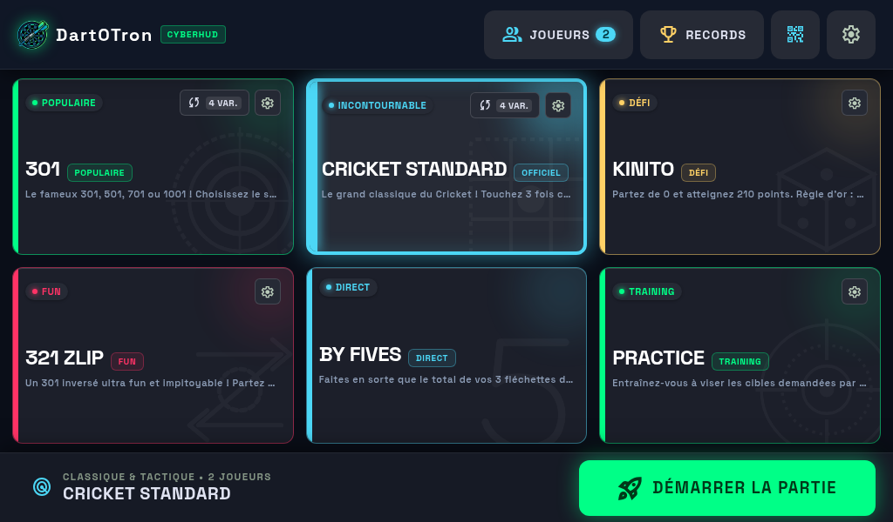
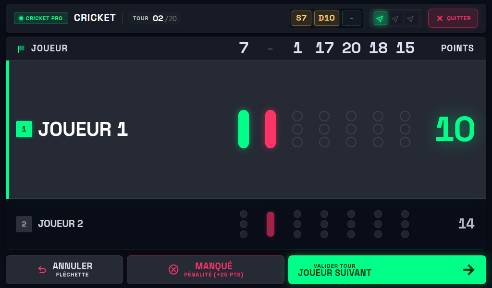
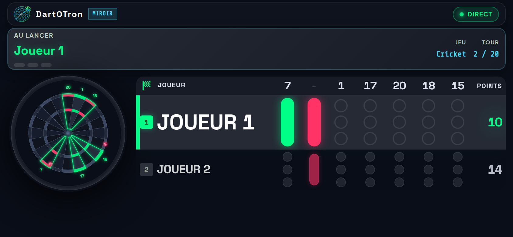

  

# DartOTron — Borne de Fléchettes Électronique

[🇬🇧 English](README.md) | **🇫🇷 Français**

---

[-brightgreen.svg)]()

Système de borne de fléchettes électronique **100 % Open-Source et Open-Hardware** conçu **sans aucune dépendance npm** (ES Modules natifs Node.js, `node:sqlite`, Web Components W3C Light DOM et Design Tokens CSS Level 4), pensé pour **Raspberry Pi**, écrans tactiles, téléviseurs et matrices de cibles **Arduino USB**.

---

## 📸 Présentation des Écrans

Découvrez l'interface CyberHUD taillée sur mesure pour les écrans Raspberry Pi (1024×600), les bornes d'arcade et les périphériques mobiles en mode paysage.

### 1. Écran d'Accueil & Sélection des Jeux
Le tableau de bord principal affiche les 6 modes de jeu avec leurs lueurs néon réactives, profils de joueurs, sélecteurs de variantes et réglages rapides.

*Fonctionnalités : Lancement de partie tactile, compteur de joueurs actifs, générateur de QR code instantané pour smartphone et modale de réglages matériels.*

---

### 2. Partie en Cours — Cricket Crazy Master
Un écran de match haute lisibilité conçu pour être visible de loin sur TV comme sur écran tactile 7 pouces. Secteurs cibles, historique des impacts et scores Cut-Throat mis à jour en temps réel à latence zéro.

*Fonctionnalités : Indicateurs d'impacts par fléchette (D1/D2/D3), secteurs cibles Crazy aléatoires à chaque tour, calcul Cut-Throat et boutons tactiles surdimensionnés.*

---

### 3. Compagnon Mobile (Mode Paysage)
Les joueurs et spectateurs peuvent connecter leur smartphone directement à la borne via le Wi-Fi local sans installer aucune application native. L'affichage en mode paysage dispose la cible interactive côte à côte avec le tableau de scores en direct.

*Fonctionnalités : Flux de tour en direct, cible tactile interactive (`<dart-board>`), suggestions de finitions (checkouts) et validation du passage au joueur suivant.*

---

## 🚀 Parcours de Montage & Guides Pas-à-Pas

Pour installer DartOTron et fabriquer votre borne de fléchettes connectée, suivez les 4 étapes séquentielles dans [`docs/`](docs/) :

1. 🛠️ [**Étape 1 : Matériel & Câblage de la Cible (`docs/01_HARDWARE.fr.md`)**](docs/01_HARDWARE.fr.md)
   - Démontage mécanique, anatomie des 6 couches, manipulation des nappes souples.
   - Schémas 3D isométriques et plan de câblage complet sur Arduino Uno.
   - Raccordement des boutons poussoirs d'arcade physiques (« Joueur Suivant », « Annuler »).

2. ⚡ [**Étape 2 : Configuration & Firmware Arduino (`docs/02_ARDUINO_FIRMWARE.fr.md`)**](docs/02_ARDUINO_FIRMWARE.fr.md)
   - Rôle du firmware officiel [`dartotron_firmware.ino`](arduino/dartotron_firmware.ino) (zéro dépendance, 9600 bauds).
   - Presets clés en main : Standard $8 \times 8$, Grande Matrice $4 \times 16$, Compacte $7 \times 12$ et Professionnelle $8 \times 16$.
   - Téléversement (Arduino IDE & `arduino-cli`) et test au moniteur série.

3. 🍓 [**Étape 3 : Installation & Kiosque Raspberry Pi (`docs/03_INSTALLATION_KIOSK.fr.md`)**](docs/03_INSTALLATION_KIOSK.fr.md)
   - Prérequis système (Node.js $\ge$ 22.5+, 0 dépendance npm) et démarrage rapide (`npm start`).
   - Script clé en main (`npm run install-rpi`) : service systemd, plein écran Chromium et permissions `dialout`.
   - Procédure de mise à jour (`git pull`).

4. 📱 [**Étape 4 : Écrans, Compagnon Mobile & Outils Dev (`docs/04_FEATURES_COMPANION.fr.md`)**](docs/04_FEATURES_COMPANION.fr.md)
   - Interface Kiosque CyberHUD ($1024 \times 600$) et calibration graphique assistée de la matrice.
   - Compagnon Mobile smartphone via QR Code (`/companion`) avec secteurs Cricket intelligents.
   - Outils développeur : Catalogue Web Components (`/showcase`) et simulateur matériel (`/simulator`).

---

## ✨ Fonctionnalités Principales

| Fonctionnalité | Statut | Description |
| :--- | :---: | :--- |
| **6 Jeux Complets** | ✅ Opérationnel | **01 (`Ho_One`)** (301/501/701/1001, Double In/Out, Master Out, Égalisation, Guide de finitions), **Cricket** (Standard, Cut Throat, Crazy, Crazy Cutthroat Master), **321 Zlip**, **Kinito**, **Par Cinq (`By_Fives`)** et **Entraînement (`Practice`)**. |
| **Zéro Dépendance npm** | ✅ Opérationnel | Exécution native sur Node.js `>= 22.5` (`node:http`, `node:sqlite`) sans étape de compilation ni paquet externe. |
| **Interface Tactile CyberHUD & `<m-hit-impact>`** | ✅ Opérationnel | Interface plein écran responsive avec animation d'impact à médaillon flouté (`scored` en vert, `penalty` en rouge, `neutral` en gris). |
| **Instance Kiosque Unique & Mode Compagnon** | ✅ Opérationnel | Une seule instance Kiosque autorisée sur `localhost` ; les appareils Wi-Fi (smartphones/tablettes) sont automatiquement redirigés (`302`) vers `/companion` en temps réel. |
| **Stockage Relationnel SQLite V2 (`data/`)** | ✅ Opérationnel | Tampon de tour atomique, historique granulaire (`dart_hits`), télémétrie (PPD, PPR, MPR) et catalogue de records dynamiques avec rétro-analyse automatique. |
| **Support Matériel Arduino USB** | ✅ Opérationnel | Lecture série non-bloquante (`/dev/ttyACM0`, `/dev/ttyUSB0`) avec assistant graphique de calibration de la matrice. |
| **Mise à Jour par Release Packagée** | ✅ Opérationnel | Commande `npm run update` téléchargeant la dernière archive officielle (`dartotron-release.tar.gz`) depuis GitHub Releases tout en préservant `data/`. |

---

## 🛠️ Architecture & Spécifications

- [**`docs/PRD.md`**](docs/PRD.md) : Product Requirements Document (Source Unique de Vérité) — vision produit, structure canonique en 6 piliers, contrats réseau et pipeline CI/CD.
- [**`docs/DESIGN.md`**](docs/DESIGN.md) : Spécification du Design System CyberHUD — palette de couleurs, tokens `--sys-*` et ergonomie tactile.
- [**`docs/TEST_INFRA.md`**](docs/TEST_INFRA.md) : Architecture du Banc d'Essais E2E — méthodologie à 4 niveaux et matrice de couverture.

---

## 🤝 Contribution

Les contributions, signalements de bugs et suggestions sont les bienvenus !
1. Utilisez les **Conventional Commits** (`feat:`, `fix:`, `docs:`, `refactor:`, `test:`).
2. Vérifiez que l'intégralité des tests passe (`npm run test:all`) avant de soumettre une Pull Request.

---

## 📄 Licence

Distribué sous licence **GNU General Public License v3.0 (GPL-3.0)**. Voir le fichier [LICENSE](LICENSE) pour plus d'informations.

---

## 🙏 Remerciements

Un immense merci au projet [**pyDarts**](https://pydarts.sourceforge.net), sans qui rien de tout ceci n'aurait été possible. Merci d'avoir ouvert la voie des cibles de fléchettes électroniques open-source et pour toute l'inspiration apportée à **DartOTron**.
