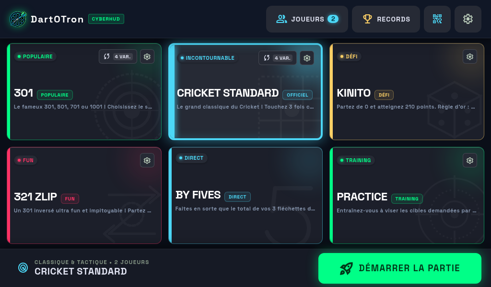
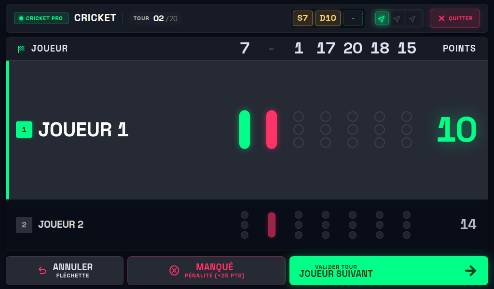
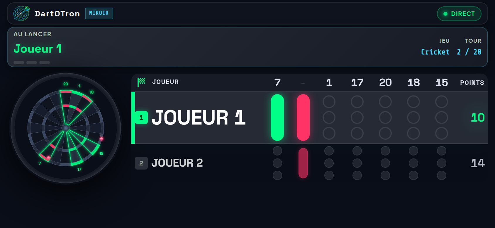

  

# DartOTron — Electronic Dartboard Arcade System

**🇬🇧 English** | [🇫🇷 Français](README.fr.md)

---

[-brightgreen.svg)]()

Modern **100% Open-Source & Open-Hardware Electronic Dartboard Arcade System** built with **Zero npm Dependencies** (native Node.js ES Modules, `node:sqlite`, W3C Light DOM Web Components, and CSS Level 4 Design Tokens), designed for **Raspberry Pi**, touchscreens, TV displays, and **Arduino USB** dartboard matrices.

---

## 📸 Interface Showcase

Experience the CyberHUD interface designed specifically for Raspberry Pi displays (1024×600), arcade cabinets, and mobile devices in landscape mode.

### 1. Lobby & Game Selector
The main arcade dashboard displays all 6 available game modes with reactive neon glows, player profiles, variant selectors, and tactile game options.

*Features: Single-touch game launching, active player counter, instant QR code generator for smartphones, and hardware configuration modal.*

---

### 2. Live Match — Cricket Crazy Master
A real-time, high-contrast match screen designed for long-distance legibility on TVs and 7" touchscreen cabinets. Target numbers, hit history, and dynamic cut-throat scores update with zero latency.

*Features: Multi-dart hit indicators (D1/D2/D3), randomized Crazy target sectors, cut-throat scoring, and oversized tactile advance buttons.*

---

### 3. Mobile Companion UI (Landscape)
Spectators and players can connect their smartphones directly to the board over local Wi-Fi without installing any native app. The landscape view provides a side-by-side display of the interactive dartboard and the live scoreboard.

*Features: Live turn feed, interactive target dartboard (`<dart-board>`), real-time checkout suggestions, and remote turn validation.*

---

## 🚀 Step-by-Step Setup & Documentation

To set up DartOTron and build your connected arcade dartboard, follow the 4 sequential guides in [`docs/`](docs/):

1. 🛠️ [**Step 1: Hardware & Dartboard Wiring (`docs/01_HARDWARE.md`)**](docs/01_HARDWARE.md)
   - Mechanical disassembly, 6-layer anatomy, flexible ribbon handling.
   - 3D isometric schematics and complete Arduino Uno wiring diagram.
   - Connecting physical arcade push buttons (*Next Player*, *Undo*).

2. ⚡ [**Step 2: Arduino Firmware Configuration (`docs/02_ARDUINO_FIRMWARE.md`)**](docs/02_ARDUINO_FIRMWARE.md)
   - Role of the official firmware [`dartotron_firmware.ino`](arduino/dartotron_firmware.ino) (zero dependencies, 9600 baud).
   - Turnkey presets: Standard $8 \times 8$, Large Arcade Matrix $4 \times 16$, Compact $7 \times 12$, and Professional $8 \times 16$.
   - Flashing (Arduino IDE & `arduino-cli`) and serial monitor test.

3. 🍓 [**Step 3: Raspberry Pi Kiosk Installation (`docs/03_INSTALLATION_KIOSK.md`)**](docs/03_INSTALLATION_KIOSK.md)
   - System prerequisites (Node.js $\ge$ 22.5+, 0 npm dependencies) and quick start (`npm start`).
   - Turnkey installer script (`npm run install-rpi`): systemd service, fullscreen Chromium kiosk, and `dialout` permissions.
   - Updating procedure (`git pull`).

4. 📱 [**Step 4: UI Screens, Companion & Dev Tools (`docs/04_FEATURES_COMPANION.md`)**](docs/04_FEATURES_COMPANION.md)
   - CyberHUD Kiosk interface ($1024 \times 600$) and visual matrix calibration assistant.
   - Smartphone Mobile Companion via QR Code (`/companion`) with smart target dimming.
   - Developer tools: Web Component Showcase (`/showcase`) and hardware serial simulator (`/simulator`).

---

## ✨ Key Features

| Feature | Status | Description |
| :--- | :---: | :--- |
| **6 Complete Dart Games** | ✅ Ready | **01 (`Ho_One`)** (301/501/701/1001, Double In/Out, Master Out, Equalize, Checkout Guide), **Cricket** (Standard, Cut Throat, Crazy, Crazy Cutthroat Master), **321 Zlip**, **Kinito**, **By Fives**, and **Practice**. |
| **Zero npm Dependencies** | ✅ Ready | Runs natively on Node.js `>= 22.5` (`node:http`, `node:sqlite`) and modern browsers without build steps or external packages. |
| **CyberHUD Touch UI & `<m-hit-impact>`** | ✅ Ready | Full-screen responsive dark arcade UI with localized blurred backdrop impact animations (`scored` green, `penalty` red, `neutral` grey). |
| **Single-Kiosk Lock & Mobile Companion** | ✅ Ready | Single active Kiosk instance locked on `localhost`; Wi-Fi devices (smartphones/tablets) automatically redirect (`302`) to `/companion` with real-time WebSocket sync. |
| **SQLite V2 Relational Storage (`data/`)** | ✅ Ready | Atomic turn buffering, granular dart hit history (`dart_hits`), player telemetry (PPD, PPR, MPR), and dynamic pattern-based records with retroactive backfill. |
| **Arduino USB Hardware Integration** | ✅ Ready | Direct non-blocking serial communication (`/dev/ttyACM0`, `/dev/ttyUSB0`) with interactive matrix calibration wizard. |
| **Release-Based Auto-Updater** | ✅ Ready | One-command update (`npm run update`) fetches the latest packaged release (`dartotron-release.tar.gz`) from GitHub Releases while preserving `data/`. |

---

## 🛠️ Architecture & Specifications

- [**`docs/PRD.md`**](docs/PRD.md): Product Requirements Document (Single Source of Truth) — product vision, 6-pillar repository structure, network contracts, and release pipeline.
- [**`docs/DESIGN.md`**](docs/DESIGN.md): CyberHUD Design System Specification — color palette, `--sys-*` design tokens, and tactile ergonomics.
- [**`docs/TEST_INFRA.md`**](docs/TEST_INFRA.md): 4-Tier E2E Test Infrastructure — testing methodology and feature verification matrix.

---

## 🤝 Contributing

Contributions, bug reports, and suggestions are welcome!
1. Use **Conventional Commits** (`feat:`, `fix:`, `docs:`, `refactor:`, `test:`).
2. Verify all tests pass before opening a PR (`npm run test:all`).

---

## 📄 License

Distributed under the **GNU General Public License v3.0 (GPL-3.0)**. See [LICENSE](LICENSE) for details.

---

## 🙏 Acknowledgments

Special thanks to the [**pyDarts**](https://pydarts.sourceforge.net) project, without which none of this would have been possible. Thank you for paving the way for open-source electronic dartboards and for being the primary source of inspiration behind **DartOTron**.
