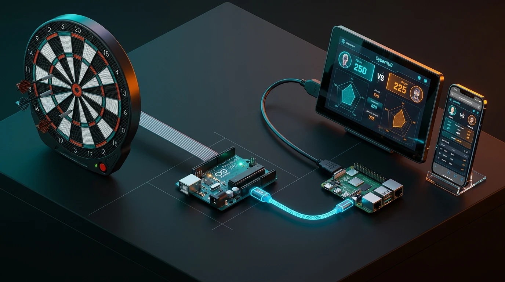
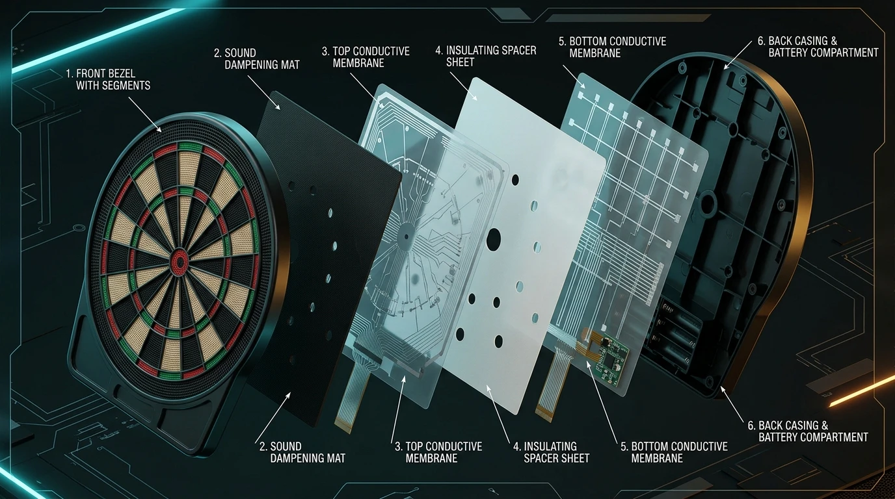
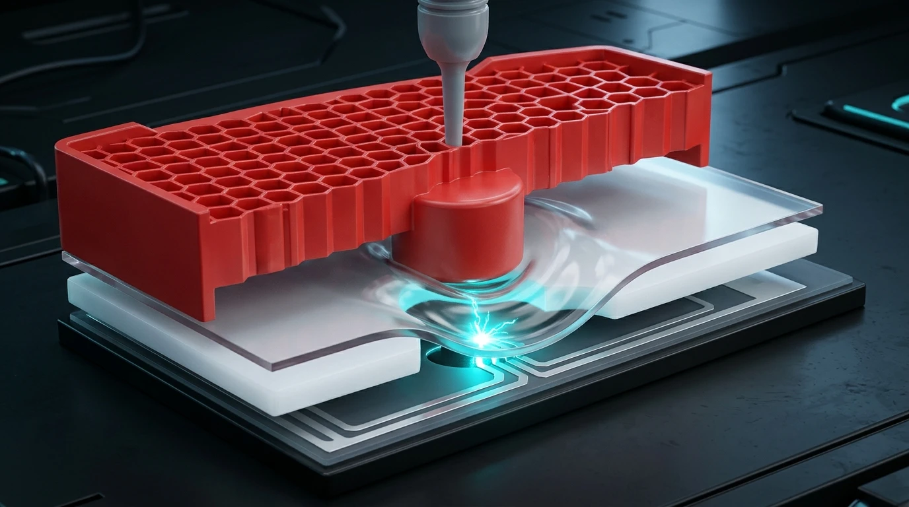
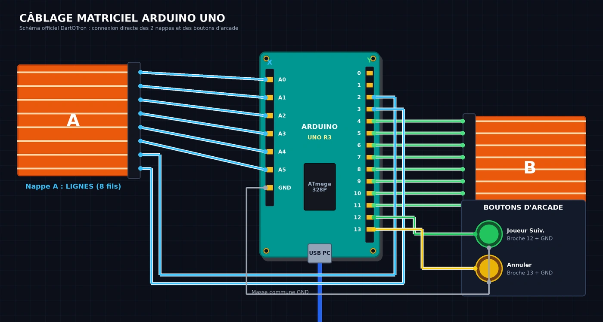

# 🛠️ Étape 1 : Matériel & Câblage de la Cible

[🇬🇧 English Version](01_HARDWARE.md) | **Français**

| Navigation |
| :--- |
| **Index** • **Étape 1 : Matériel** • [Étape 2 : Firmware Arduino →](02_ARDUINO_FIRMWARE.fr.md) |

---

DartOTron permet de réutiliser n'importe quelle **cible de fléchettes électronique grand public** (Decathlon Canaveral, Viper, Arachnid, Carromco ou modèle vintage d'occasion) et de la transformer en une véritable **borne d'arcade connectée**.

Cette première étape vous accompagne dans le démontage mécanique de la cible et le raccordement de ses nappes souples à un microcontrôleur **Arduino Uno** (ou Mega).

---

## 🌟 Vue d'Ensemble du Système

Fini l'électronique des années 90 et les bips stridents : DartOTron remplace la carte mère d'origine par un Arduino qui transmet les touches au Raspberry Pi ou à votre PC.



```
[ Cible Électronique ] ──(2 nappes souples)──▶ [ Arduino Uno ] ──(Câble USB)──▶ [ Raspberry Pi / PC ]
                                                                                   │ (Wi-Fi)
                                                                            [ Smartphone / Tablette ]
```

---

## 🧰 Liste du Matériel Nécessaire

1. **Une cible électronique à pointes souples (Soft-Tip)** : la plupart des modèles du commerce (anciens ou neufs) fonctionnent sur le même principe de membrane plastique.
2. **Une carte Arduino Uno R3** (ou Nano, ou Mega 2560 si votre cible a plus de 16 broches au total).
3. **Des câbles de prototypage Dupont** (femelle-mâle ou femelle-femelle 2.54 mm) pour relier les nappes de la cible à l'Arduino.
4. **Un câble USB** pour raccorder l'Arduino au Raspberry Pi ou PC.
5. *(Optionnel mais recommandé)* **2 boutons d'arcade** (type Sanwa 24mm ou 30mm) pour changer de joueur ou annuler une fléchette directement depuis la cible sans toucher l'écran.

---

## 📦 Démontage & Anatomie de la Cible

Retirez les vis au dos de la cible pour séparer la coque arrière de la face avant.



À l'intérieur, vous découvrez l'empilement qui compose votre cible :
1. **La face avant avec les segments ajourés** (simples, doubles, triples, bullseye).
2. **Une mousse ou caoutchouc d'amortissement**.
3. **Le sandwich de détection** : deux feuilles plastiques transparentes (membranes) recouvertes de pistes conductrices en encre d'argent, séparées par une feuille plastique isolante percée de trous.
4. **Deux nappes souples plates** qui sortent de ce sandwich : ce sont elles qui nous intéressent !

> [!CAUTION]
> **Attention aux nappes souples !**  
> Les pistes en encre d'argent ne supportent **ni pliure nette, ni fer à souder** (le plastique fondrait immédiatement).
> - Si les nappes sont enfichées dans des connecteurs sur la vieille carte mère : débranchez-les simplement.
> - Si elles sont soudées, dessoudez les connecteurs femelles de la carte mère pour pouvoir y brancher vos fils Dupont.

---

## ⚡ Comment Fonctionne la Détection ?

Une cible de fléchettes n'a pas 62 câbles différents : elle fonctionne sous forme de **matrice de contact** (croisement de lignes et de colonnes).



- **Au repos** : la feuille isolante centrale maintient les deux membranes conductrices séparées.
- **À l'impact d'une fléchette** : la pointe reste logée dans le segment plastique sans jamais toucher la membrane. C'est le poussoir cylindrique sous le segment qui enfonce la membrane supérieure à travers l'orifice de l'isolant.
- **Le signal** : l'intersection unique (par exemple *Ligne 4* $\times$ *Colonne 2*) est mise en contact électrique. L'Arduino détecte immédiatement ces coordonnées et envoie un caractère sur le câble USB vers DartOTron.

---

## 🔌 Câblage sur l'Arduino Uno

Branchez les broches des deux nappes souples et des boutons arcade sur les connecteurs de l'Arduino Uno selon le schéma officiel ci-dessous :



### 1. La première nappe (Nappe A - Lignes, 8 fils)
Branchez les 8 pistes sur les entrées suivantes de l'Arduino :
- Pistes 1 à 6 $\rightarrow$ Broches analogiques **A0, A1, A2, A3, A4, A5**
- Pistes 7 et 8 $\rightarrow$ Broches numériques **2 et 3** (en passant sous la carte)

### 2. La deuxième nappe (Nappe B - Colonnes, 8 fils)
Branchez les 8 pistes directement en face sur les sorties numériques :
- Pistes 1 à 8 $\rightarrow$ Broches numériques **4, 5, 6, 7, 8, 9, 10, 11**

### 3. Les boutons d'arcade physiques (Option arcade très recommandée)
Pour un confort d'arcade total sans avoir à toucher un écran pendant la partie :
- **Bouton Joueur Suivant** (Vert) : relié entre la **Broche numérique 12** et la broche **GND** (masse).
- **Bouton Annuler Flèche** (Jaune) : relié entre la **Broche numérique 13** et la broche **GND** (masse).

---

| Étape Précédente | Sommaire | Étape Suivante |
| :--- | :---: | ---: |
| [🏠 Retour à l'Accueil](../README.fr.md) | **Guide Matériel 1/4** | [⚡ Étape 2 : Firmware Arduino →](02_ARDUINO_FIRMWARE.fr.md) |
