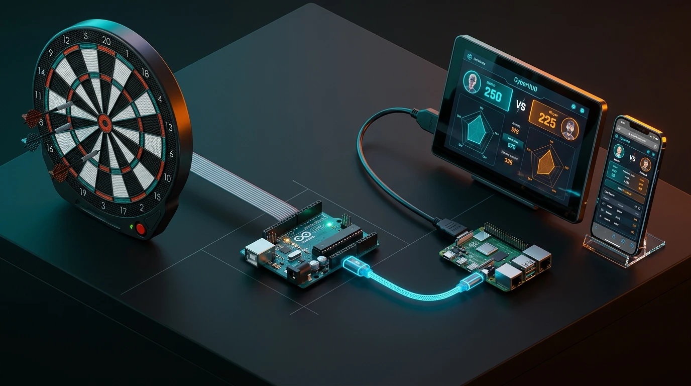
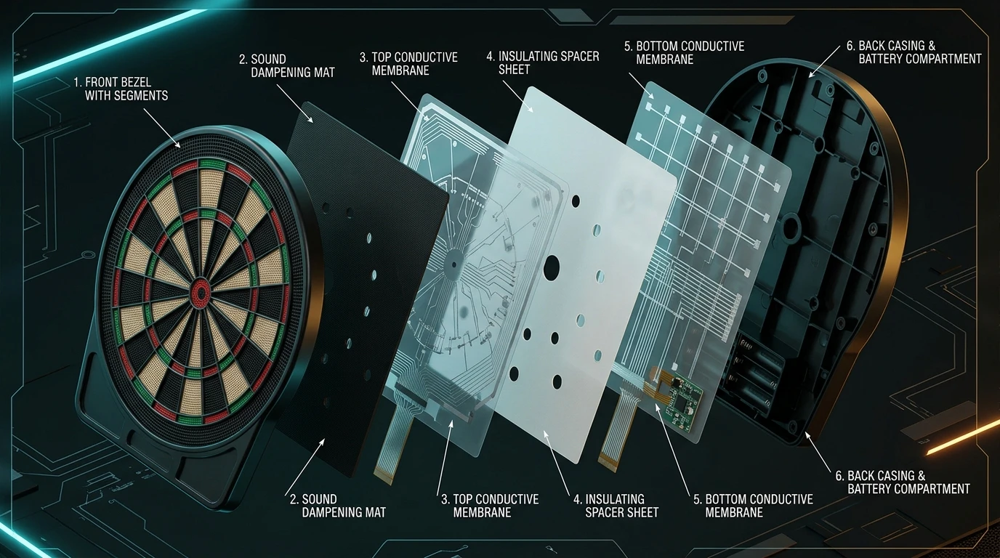
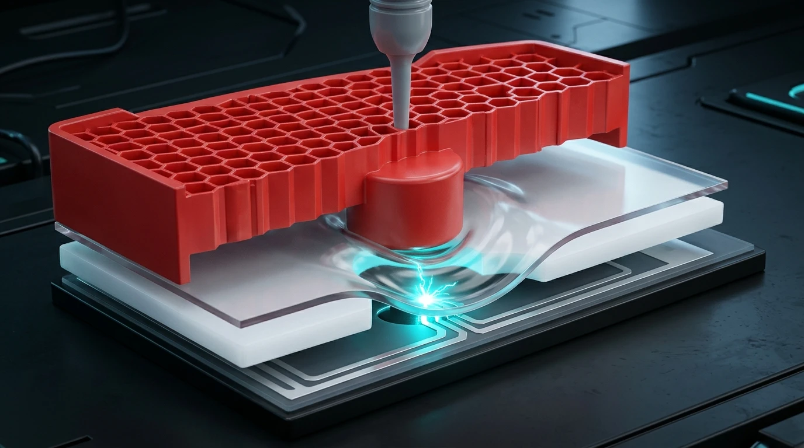
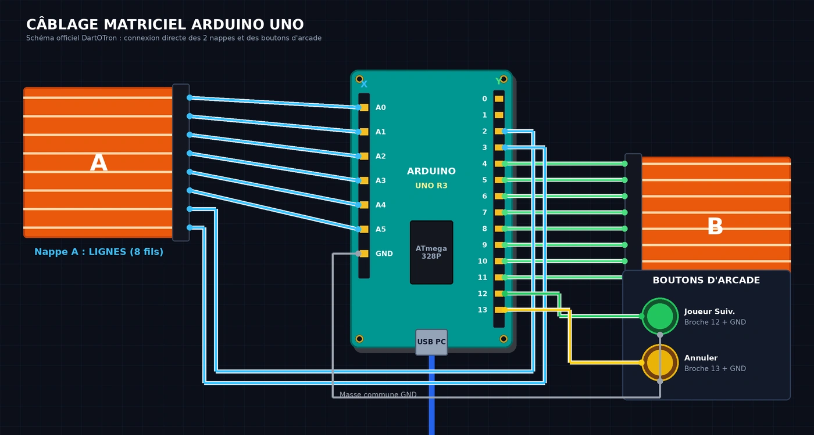

# 🛠️ Step 1: Hardware & Dartboard Wiring

**English** | [🇫🇷 Version Française](01_HARDWARE.fr.md)

| Navigation |
| :--- |
| **Index** • **Step 1: Hardware** • [Step 2: Arduino Firmware →](02_ARDUINO_FIRMWARE.md) |

---

DartOTron allows you to upcycle any standard or vintage **commercial electronic dartboard** (Decathlon Canaveral, Viper, Arachnid, Carromco, etc.) into a modern **connected arcade dart machine**.

This first step walks you through the physical disassembly of the board and wiring its flexible ribbons to an **Arduino Uno** (or Mega) microcontroller.

---

## 🌟 System Overview

Say goodbye to outdated 90s sound chips and tiny segment displays: DartOTron replaces the stock electronics with an Arduino that streams hit coordinates over USB to a Raspberry Pi or PC.



```
[ Electronic Dartboard ] ──(2 ribbon cables)──▶ [ Arduino Uno ] ──(USB Cable)──▶ [ Raspberry Pi / PC ]
                                                                                   │ (Local Wi-Fi)
                                                                            [ Smartphone / Tablet ]
```

---

## 🧰 Required Hardware

1. **A commercial soft-tip electronic dartboard**: almost all models (budget, vintage, or modern) use the same flexible membrane switch technology.
2. **An Arduino Uno R3** board (or Nano, or Mega 2560 if your dartboard matrix has more than 16 pins total).
3. **Dupont jumper wires** (female-to-male or female-to-female 2.54 mm) to connect the matrix ribbons to the Arduino headers.
4. **A standard USB cable** to connect the Arduino to the Raspberry Pi or PC.
5. *(Optional but recommended)* **2 arcade push buttons** (e.g., 24mm or 30mm Sanwa style) for *Next Player* and *Undo Dart* so players don't have to touch a screen during play.

---

## 📦 Disassembly & Dartboard Anatomy

Remove the screws on the back cover of your dartboard to separate the backplate from the front face.



Inside, you will find the layered assembly that makes up your board:
1. **Front face bezel with sliding target segments** (singles, doubles, triples, bullseye).
2. **Rubber or foam cushioning mat**.
3. **The sensor sandwich**: two transparent flexible plastic sheets printed with conductive silver ink traces, separated by a thin spacer sheet with holes under each segment.
4. **Two flat flexible ribbon cables** protruding from this sandwich: these are the only cables we need!

> [!CAUTION]
> **Handle flexible ribbons with care!**  
> Silver ink printed on plastic film **cannot withstand soldering or sharp folds**:
> - If ribbons plug into female sockets on the original circuit board: simply pull them out gently.
> - If ribbons are permanently soldered, desolder the female header sockets from the old board to use them as an adapter for your Dupont jumper wires.

---

## ⚡ How Does Matrix Detection Work?

An electronic dartboard does not have 62 individual wires. It operates as a **contact matrix** (rows intersecting columns).



- **At rest**: the middle spacer sheet keeps the two conductive membranes apart.
- **On dart impact**: the plastic tip stays safely embedded in the front honeycomb hole of the segment. The blunt cylindrical foot under the segment pushes the upper membrane through the spacer hole onto the lower membrane.
- **The trigger**: the unique intersection (e.g., *Row 4* $\times$ *Column 2*) momentarily closes. The Arduino instantly senses this connection and transmits a corresponding character over the USB serial connection.

---

## 🔌 Wiring to the Arduino Uno

Connect the pins of the two ribbon cables and arcade push buttons to the Arduino Uno headers as shown below:



### 1. First Ribbon (Ribbon A - Rows, 8 wires)
Connect these 8 traces to the following Arduino inputs:
- Traces 1 to 6 $\rightarrow$ Analog pins **A0, A1, A2, A3, A4, A5**
- Traces 7 and 8 $\rightarrow$ Digital pins **2 and 3** (routing cleanly under the board)

### 2. Second Ribbon (Ribbon B - Columns, 8 wires)
Connect these 8 traces straight across to the digital outputs:
- Traces 1 to 8 $\rightarrow$ Digital pins **4, 5, 6, 7, 8, 9, 10, 11**

### 3. Physical Arcade Push Buttons (Highly Recommended)
Avoid touching screens during games:
- **Next Player Button** (Green): connected between **Pin 12** and **GND**.
- **Undo Dart Button** (Yellow): connected between **Pin 13** and **GND**.

---

| Previous Step | Overview | Next Step |
| :--- | :---: | ---: |
| [🏠 Back to Home](../README.md) | **Hardware Guide 1/4** | [⚡ Step 2: Arduino Firmware →](02_ARDUINO_FIRMWARE.md) |
