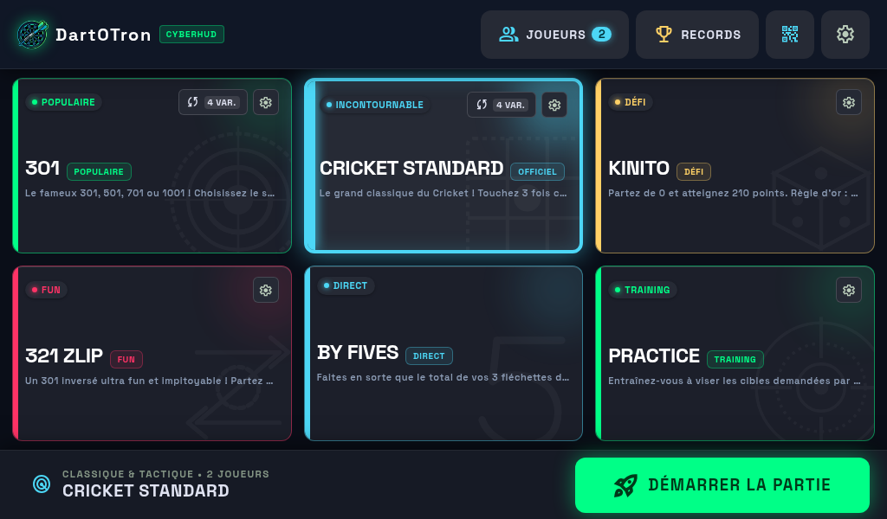
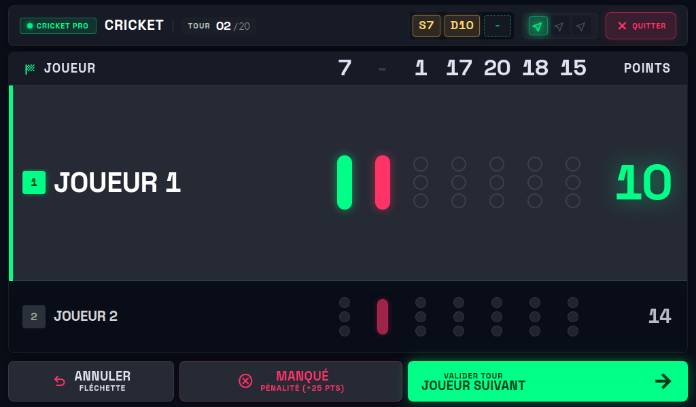
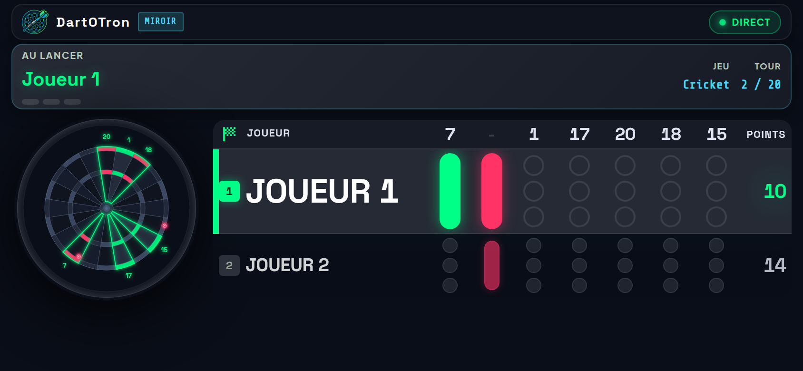

# 📱 Étape 4 : Écrans, Compagnon Mobile & Outils Développeur

[🇬🇧 English Version](04_FEATURES_COMPANION.md) | **Français**

| Navigation |
| :--- |
| [← Étape 3 : Installation Kiosk RPi](03_INSTALLATION_KIOSK.fr.md) • **Étape 4 : Écrans & Companion** • [🏠 Accueil](../README.fr.md) |

---

Cette quatrième étape présente l'interface CyberHUD de DartOTron, l'assistant de calibration visuelle de la cible, le compagnon mobile pour smartphone et les outils pour développeurs.

---

## 🖥️ 1. L'Interface Kiosque Principale

L'interface de DartOTron a été pensée pour un affichage tactile ou piloté à distance sur les écrans de bornes d'arcade (notamment l'écran officiel Raspberry Pi 7 pouces en résolution $1024 \times 600$).

### Le Lobby d'Accueil
- **Sélection des Jeux** : X01 (301, 501, 701...), Cricket (Standard, Cut Throat, Crazy Master), By Fives, Halve-It, etc.
- **Gestion des Joueurs** : Ajout à la volée, attribution de couleurs de profil personnalisées, statistiques en temps réel (PPD, MPR, 3-Dart Average).
- **Options de Jeu avancées** : Double In / Double Out, options égalité, pénalités de miss personnalisées.

---

## 🎯 2. Assistant de Calibration Visuelle de la Cible

Aucun fichier de configuration textuel à éditer manuellement ! DartOTron intègre un assistant de calibration graphique basé sur le composant Web natif `<dart-board>` :

1. Cliquez sur la **roue crantée (Réglages)** en haut à droite de l'écran.
2. Rendez-vous dans l'onglet **Matrice & Cible**.
3. Cliquez sur un segment à l'écran (ex: le **Triple 20**) :
   - Le segment entre en surbrillance jaune clignotante (état armé).
4. Appuyez sur le segment physique correspondant sur votre cible réelle (avec le doigt ou une fléchette).
5. **Validation immédiate** : DartOTron capture le caractère série émis par l'Arduino, l'associe au segment et le mémorise instantanément dans la base SQLite locale.
6. Répétez l'opération pour les segments voulus ainsi que pour les boutons physiques (« Joueur Suivant », « Annuler »).

---

## 📱 3. Le Compagnon Mobile (`/companion`)

Chaque joueur peut suivre la partie en direct et interagir depuis son propre smartphone sans encombrer la borne principale :

- **Accès instantané par QR Code** : Ouvrez le menu de partie pour afficher le QR Code et flashez-le depuis n'importe quel smartphone connecté au même réseau Wi-Fi local.
- **Mode Paysage & Portrait Responsive** : L'interface s'adapte automatiquement, affichant la cible interactive `<dart-board>` côte à côte avec le tableau de score.
- **Secteurs Intelligents (Cricket)** : Les chiffres fermés par tous les joueurs sont automatiquement grisés et leurs numéros masqués, indiquant en temps réel les cibles encore actives.
- **Commandes Déportées** : Passer au joueur suivant ou annuler un tir directement depuis le creux de la main.

---

## 💻 4. Outils Développeur & Mode Hack (`NODE_ENV=dev`)

En mode développement (`npm run dev` ou `NODE_ENV=dev npm start`), DartOTron active deux outils puissants accessibles dans le navigateur :

### Le Showcase de Composants Web (`/showcase`)
- Présentation interactive de tous les Web Components Light DOM de l'architecture CyberHUD : `<dart-board>`, `<scoreboard-ho-one>`, `<scoreboard-cricket>`, `<hud-tabs>`, etc.
- Permet de tester les thèmes, les états de victoire, et les animations de touches.

### Le Simulateur Matériel Série (`/simulator`)
- Permet de développer et de jouer à DartOTron **sans aucun matériel physique branché**.
- Affiche une cible interactive virtuelle qui injecte directement des trames série simulées dans le moteur de jeu de DartOTron comme si un véritable Arduino était connecté en USB.

---

| Étape Précédente | Sommaire | Étape Suivante |
| :--- | :---: | ---: |
| [← Étape 3 : Installation Kiosk RPi](03_INSTALLATION_KIOSK.fr.md) | **Guide Écrans 4/4** | [🏠 Retour à l'Accueil](../README.fr.md) |
