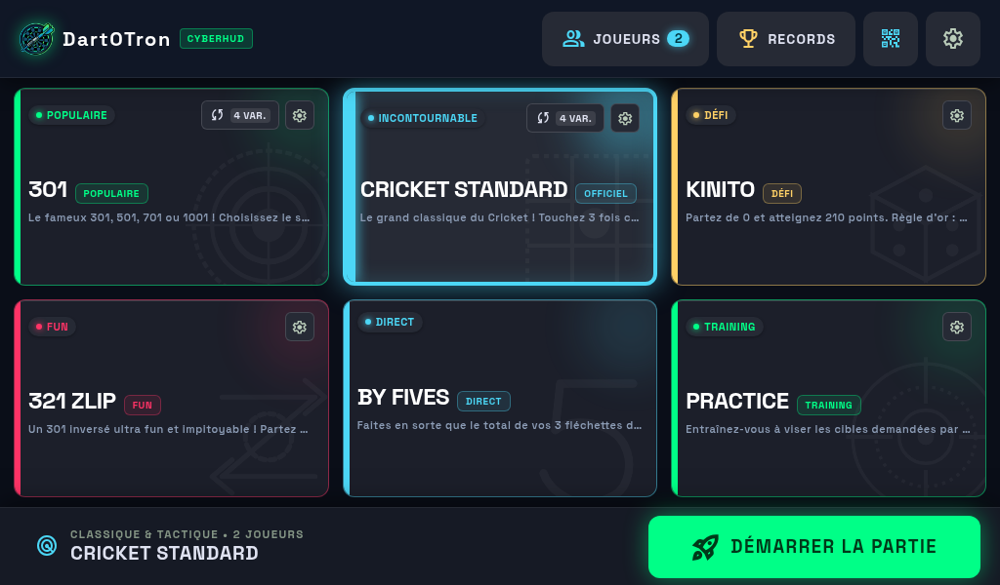
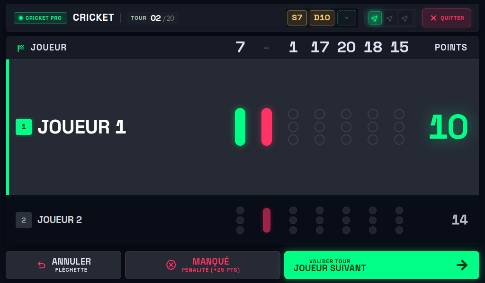
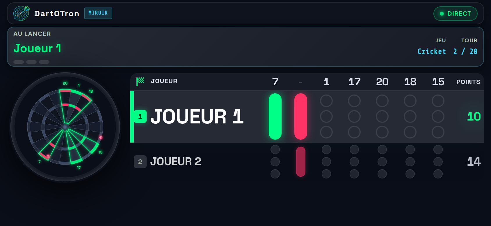

# 📱 Step 4: UI Screens, Mobile Companion & Developer Tools

**English** | [🇫🇷 Version Française](04_FEATURES_COMPANION.fr.md)

| Navigation |
| :--- |
| [← Step 3: Raspberry Pi Kiosk Setup](03_INSTALLATION_KIOSK.md) • **Step 4: Features & Companion** • [🏠 Home](../README.md) |

---

This fourth step covers the DartOTron CyberHUD arcade interface, the interactive dartboard calibration tool, the smartphone mobile companion, and built-in developer tools.

---

## 🖥️ 1. Main Kiosk Interface

The DartOTron interface is optimized for tactile arcade displays, especially the official 7-inch Raspberry Pi touchscreen ($1024 \times 600$ resolution).

### The Lobby
- **Game Mode Selection**: X01 (301, 501, 701...), Cricket (Standard, Cut Throat, Crazy Master), By Fives, Halve-It, and more.
- **Player Management**: On-the-fly player registration, personalized profile colors, live career stats (PPD, MPR, 3-Dart Average).
- **Match Options**: Double In / Double Out, equal turns, customizable miss penalty options.

---

## 🎯 2. Interactive Visual Dartboard Calibration

No tedious manual configuration files! DartOTron features a visual calibration assistant powered by the `<dart-board>` native Web Component:

1. Click the **gear icon (Settings)** at the top right of the kiosk screen.
2. Navigate to the **Matrix & Dartboard** tab.
3. Click any target segment on screen (e.g., **Triple 20**):
   - The segment enters an armed state with a flashing yellow highlight.
4. Press the corresponding physical segment on your real dartboard with a finger or soft-tip dart.
5. **Instant association**: DartOTron captures the incoming ASCII serial byte from the Arduino, maps it to the target segment, and commits it directly to the local SQLite database.
6. Repeat for remaining segments and physical arcade buttons (*Next Player*, *Undo*).

---

## 📱 3. Mobile Companion (`/companion`)

Players can track scores and control game flow directly from their personal smartphones without crowding the main cabinet:

- **Instant QR Code Access**: Open the in-game menu to display a connection QR code; scan it with any phone connected to the same local Wi-Fi.
- **Responsive Landscape & Portrait Views**: Layout adapts dynamically, rendering the `<dart-board>` component side by side with the live scoreboard.
- **Smart Target Dimming (Cricket)**: Numbers closed by all players dim automatically and hide their rim labels, showing only viable targets in real time.
- **Remote Controls**: Advance to the next player or undo accidental hits from the palm of your hand.

---

## 💻 4. Developer & Hacker Tools (`NODE_ENV=dev`)

Running in development mode (`npm run dev` or `NODE_ENV=dev npm start`) unlocks two specialized browser tools:

### Web Component Showcase (`/showcase`)
- An interactive component catalog displaying all Light DOM CyberHUD components: `<dart-board>`, `<scoreboard-ho-one>`, `<scoreboard-cricket>`, `<hud-tabs>`, etc.
- Test responsive states, victory animations, and color themes.

### Hardware Serial Simulator (`/simulator`)
- Allows developing, testing, and playing DartOTron **without any physical dartboard or Arduino attached**.
- An interactive virtual board that injects simulated serial character hits directly into the game engine via WebSockets.

---

| Previous Step | Overview | Next Step |
| :--- | :---: | ---: |
| [← Step 3: Raspberry Pi Kiosk Setup](03_INSTALLATION_KIOSK.md) | **Features Guide 4/4** | [🏠 Back to Home](../README.md) |
