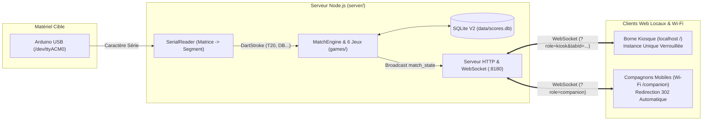

# Product Requirements Document (PRD) — DartOTron (`v1.0`)

---

## 1. Métadonnées et Rôle du Document

| Propriété | Valeur |
| :--- | :--- |
| **Nom du projet** | DartOTron (`dartotron`) |
| **Statut du document** | **Source Unique de Vérité (Single Source of Truth)** |
| **Version de référence** | `1.0.0` |
| **Matériel cible** | Raspberry Pi (3B+ / 4 / 5) + Matrice cible électronique USB Arduino (`/dev/ttyACM0`, `/dev/ttyUSB0`) + Écran tactile / TV HDMI |
| **Environnement d'exécution** | Node.js `>= 22.5` (ES Modules natifs, `node:http`, `node:sqlite`, **0 dépendance npm**) |
| **Licence** | GNU General Public License v3.0 (`GPL-3.0`) |

> [!IMPORTANT]
> Ce PRD constitue la **référence normative unique** du dépôt `Ldo-fr/DartOTron`. Toute évolution du serveur, du moteur de jeu, des Web Components, des feuilles de style CSS, des tests ou des pipelines CI/CD doit respecter les contrats d'architecture, de périmètre et de nommage définis dans ce document.
> - Pour la charte graphique et esthétique CyberHUD : voir [`docs/DESIGN.md`](DESIGN.md).
> - Pour l'architecture et la méthodologie du banc d'essais E2E à 4 niveaux : voir [`docs/TEST_INFRA.md`](TEST_INFRA.md).

---

## 2. Vision Produit, Périmètre et Non-Objectifs

### 2.1. Problématique & Contexte
Les cibles de fléchettes électroniques traditionnelles souffrent d'interfaces figées, d'une électronique propriétaire difficilement réparable et d'une absence de suivi statistique avancé. Les alternatives logicielles existantes reposent souvent sur des piles lourdes (frameworks front-end complexes, chaînes de compilation Webpack/Vite, dizaines de paquets npm natifs cassant à chaque mise à jour de Node.js sur ARM/Raspberry Pi).

### 2.2. Objectif Produit
Fournir un système de borne de fléchettes électronique **100 % Open-Source, Open-Hardware, autonome en local et sans aucune dépendance externe (`0 npm dependency`)** :
1. **Zéro dépendance & Pérennité maximale** : Exécution directe par Node.js (`node:http`, `node:sqlite`, `node:fs`) côté serveur et standards W3C purs (ES Modules, Custom Elements Light DOM, CSS Level 4 Nesting & Design Tokens) côté client.
2. **Expérience Arcade Tactile CyberHUD Plein Écran** : Interface fluide et responsive adaptée aux écrans tactiles de bornes comme aux écrans TV 16:9, avec retour sonore et visuel contextuel (`<m-hit-impact>`).
3. **Architecture Kiosque Unique + Compagnon Mobile Wi-Fi** : Garantir qu'une seule instance maîtresse pilote la partie sur la borne (`localhost`), tout en redirigeant automatiquement les smartphones/tablettes connectés sur le réseau local vers l'écran **Compagnon (`/companion`)** synchronisé en temps réel via WebSocket.
4. **Mise à jour par Release Packagée** : Mise à jour de la borne depuis les archives de release GitHub officielles (`dartotron-release.tar.gz`) sans jamais altérer la base de données locale (`data/scores.db`) ni la configuration (`data/dartotron.json`).
5. **Internationalisation Native Multilingue** : Interface 100 % bilingue/multilingue sans dépendance externe (`0 npm dependency`) supportant le Français (`fr`), l'Anglais (`en`), le Néerlandais (`nl`) et l'Allemand (`de`), avec bascule réactive à chaud sans rechargement de page et adaptation contextuelle du clavier virtuel tactile.

### 2.3. Hors-Périmètre Explicite (Non-Goals)
Afin de préserver la légèreté et la fiabilité du système sur Raspberry Pi, les éléments suivants sont **exclus du périmètre** :
- **Dépendances npm d'exécution ou outils de build (Webpack, Vite, Sass, Tailwind CLI)** : Strictement interdits. Tout fichier JS et CSS servi dans `public/` est directement exécutable par Chromium.
- **Shadow DOM (`attachShadow`)** : Écarté au profit exclusif du **Light DOM** couplé au **CSS Nesting natif (`&`)** afin de garantir le partage direct des Design Tokens `--sys-*` et des polices d'icônes Material Symbols.
- **Raccourcis clavier physiques en partie** : La borne est pilotée exclusivement par la cible électronique USB, l'écran tactile du kiosque et le bouton d'avancement du mode Compagnon mobile.
- **Services Cloud externes** : Aucune donnée de jeu ou de joueur n'est envoyée sur Internet ; l'intégralité du stockage réside dans `data/`.

---

## 3. Architecture et Structure Canonique du Dépôt

### 3.1. Flux d'Architecture Globale



### 3.2. Arborescence Canonique en 6 Piliers

```text
dartotron/
├── .github/workflows/                      # Pipelines CI/CD (ci.yml, cleanup-branch.yml, release.yml)
├── arduino/                                # Pilier 1 : Firmware Arduino & schémas matériels Open-Hardware
├── docs/                                   # Pilier 2 : Documentation de référence
│   ├── PRD.md                              # Ce document (Source Unique de Vérité produit & architecture)
│   ├── DESIGN.md                           # Spécification du Design System CyberHUD
│   └── TEST_INFRA.md                       # Architecture et méthodologie du banc d'essais E2E
├── public/                                 # Pilier 3 : Front-End Vanilla ES Modules, Light DOM & CSS Modulaire
│   ├── index.html                          # Point d'entrée Kiosque (0 attribut style= statique)
│   ├── components/                         # 17 Web Components Atomiques (Light DOM, double enregistrement)
│   ├── css/                                # Architecture CSS Modulaire (tokens, base, layout, components, views)
│   ├── i18n/                               # Dictionnaires multilingues JSON (fr.json, en.json, nl.json, de.json)
│   ├── js/                                 # Contrôleurs applicatifs & lib i18n (app.js, Lobby, Match, Settings, i18n.js)
│   ├── companion/                          # Application satellite mobile (/companion)
│   ├── simulator/                          # Simulateur matériel de cible (/simulator en mode --dev)
│   └── showcase/                           # Workbench interactif des Web Components (/showcase en mode --dev)
├── scripts/                                # Pilier 4 : Déploiement, Kiosque & Mise à jour par Release
│   ├── install-raspberry.sh                # Installation initiale systemd + autostart Chromium Kiosk
│   ├── update-raspberry.sh                 # Mise à jour depuis la dernière GitHub Release (dartotron-release.tar.gz)
│   ├── start-kiosk.sh                      # Lancement Chromium --kiosk plein écran sans veille
│   ├── dartotron.service                     # Unité systemd du serveur Node.js
│   └── dartotron-kiosk.desktop               # Entrée XDG Autostart pour l'environnement graphique
├── server/                                 # Pilier 5 : Serveur HTTP/WS, Moteur de Match, Jeux & SQLite V2
│   ├── index.js                            # Serveur HTTP/WS, garde d'instance Kiosque, redirection Wi-Fi 302
│   ├── config.js                           # Gestionnaire de configuration JSON (data/dartotron.json)
│   ├── scores.js                           # Façade de statistiques, records dynamiques et rétro-analyse
│   ├── serial.js                           # Lecture non-bloquante du port série USB Arduino
│   ├── db/                                 # Schéma SQLite V2, migrations et requêtes préparées
│   ├── engine/                             # MatchEngine, CGame, CPlayer, CHandicap
│   └── games/                              # 6 modules de jeux (Ho_One, Cricket, 321_Zlip, Kinito, By_Fives, Practice)
├── test/                                   # Pilier 6 : Banc de tests automatisés (Unitaires + E2E 4 Tiers)
│   ├── test-games.js                       # 37 tests unitaires et d'intégration moteur/BDD/HTTP
│   └── e2e/                                # 187 tests E2E d'architecture CSS, Web Components et scénarios
├── sounds/                                 # Effets sonores MP3/WAV servis par /sounds/*
├── LICENSE                                 # Licence GNU GPL v3.0
├── package.json                            # Manifeste Node.js et scripts d'exploitation
├── README.md                               # Documentation principale (Anglais)
└── README.fr.md                            # Documentation principale (Français)
```

---

## 4. Contrats d'Architecture et d'Interfaces

### 4.1. Contrat d'Accès Réseau : Instance Kiosque Unique & Redirection Compagnon
Pour éviter les conflits d'état (ex: timers de transition déclenchés en double par plusieurs appareils sur le même Wi-Fi) :
1. **Redirection HTTP (`302 -> /companion`)** : Toute requête `GET /` ou `/index.html` provenant d'une adresse IP non-locale (appareil Wi-Fi distant, hors `127.0.0.1` / `::1` / `localhost`) est automatiquement redirigée vers `/companion`.
2. **Disponibilité permanente de `/companion`** : La route `/companion` et ses ressources statiques sont accessibles aussi bien en production (`npm start`) qu'en développement (`npm run dev`). En revanche, `/simulator` et `/showcase` restent strictement réservés au mode `--dev` (`404` en production).
3. **Verrouillage d'onglet Kiosque (`role=kiosk`)** : Sur `localhost`, un seul onglet Kiosque actif est autorisé à la fois (via `BroadcastChannel('dartotron_kiosk_lock')` et vérification WebSocket `activeKioskSocket` par `tabId`). Tout second onglet ouvert sur `localhost` est redirigé vers `/companion`.
4. **Déduplication des transitions de tour (`WAITING_PLAYER_ADVANCE`)** : Les minuteries automatiques de fin de tour envoient le signal idempotent `WAITING_PLAYER_ADVANCE` (ignoré si l'état n'est plus `waiting_player`), et tout `PLAYERBUTTON` reçu moins de `800 ms` après la sortie de `waiting_player` est dédupliqué au lancer 1.

### 4.2. Contrat du Moteur de Jeu et de l'Animation d'Impact (`<m-hit-impact>`)
Chaque fléchette évaluée par `MatchEngine.handleInput()` produit un objet `lastHit` normalisé incluant l'évaluation contextuelle de la touche selon les règles du jeu actif :

```json
{
  "id": 14,
  "key": "T20",
  "player": "Alex",
  "playerIdent": 0,
  "round": 2,
  "dart": 1,
  "points": 60,
  "status": "scored",
  "reason": "scored",
  "penalty": 0
}
```

| Statut (`lastHit.status`) | Variante `<m-hit-impact>` | Couleur Token | Cas d'application |
| :--- | :---: | :--- | :--- |
| **`"scored"`** | `variant="scored"` | Vert Néon (`--sys-color-primary` `#00ff87`) | Touche valide qui marque des points (X01, Kinito, 321 Zlip), ouvre/ferme/score au Cricket, atteint la cible au Practice, ou valide un multiple de 5 au By Fives. |
| **`"penalty"`** | `variant="penalty"` | Rouge Laser (`--sys-color-danger` `#ff3366`) | Bust (X01, Kinito, 321 Zlip), pénalité au Cricket *Crazy Cutthroat Master*, 3e fléchette non multiple de 5 au By Fives, ou fléchette manquée (`MISSDART`). |
| **`"neutral"`** | `variant="neutral"` | Gris Acier (`--sys-color-text-muted` `#849585`) | Touche sur la cible ignorée sans pénalité (numéro hors contrat ou déjà fermé au Cricket standard, Simple avant ouverture du Double-In au X01, hors cible imposée au Practice). |

### 4.3. Contrat du Design System CSS & Web Components Light DOM
1. **Design Tokens (`public/css/tokens/tokens.css`)** : Toutes les variables suivent la nomenclature `--sys-[concept]-[variante]` (`--sys-color-*`, `--sys-spacing-*`, `--sys-font-*`, `--sys-radius-*`, `--sys-shadow-*`, `--sys-transition-*`, `--sys-zindex-*`) avec alias de rétrocompatibilité.
2. **Web Components Light DOM (`public/components/`)** :
   - Tous les composants héritent de `HTMLElement` et effectuent leur rendu dans `this.innerHTML` (**aucun appel à `this.attachShadow()`**).
   - Chaque composant est enregistré sous son tag atomique (`a-*`, `m-*`, `o-*`) et son alias historique (ex: `m-hit-impact` et `hit-impact`).
   - Les feuilles de style de composants (`public/css/components/`) utilisent le tag du Custom Element comme sélecteur racine absolu et encapsulent les règles enfants via le **CSS Nesting natif (`&`)**.
3. **Politique Zéro Style Inline Statique** : Aucun attribut `style="..."` statique dans le HTML ou les templates de composants, et aucune affectation `this.style.*` statique dans les constructeurs/`connectedCallback`. Seules les valeurs dynamiques calculées à l'exécution (largeurs de jauges en `%`, barres de compte à rebours) sont autorisées.

### 4.4. Contrat de Stockage Relationnel SQLite V2 (`data/scores.db`)
La base SQLite gérée via `node:sqlite` repose sur 6 tables normatives :
- `players` : Identifiants uniques, noms et dates de création des joueurs.
- `games_history` : Historique des parties terminées (jeu, variante, gagnant, nombre de tours).
- `dart_hits` : Journal granulaire de chaque fléchette lancée (permettant le calcul de statistiques et la rétro-analyse de nouveaux motifs de records via `BackfillRecord`).
- `records_definitions` : Catalogue dynamique des records système (`is_system = 1`) et personnalisés (`pattern`: `chimay_bleu`, `hat_trick`, `shanghai`, `suite`, etc.).
- `records` : Table unifiée des performances et records enregistrés par variante de jeu (`301`, `501`, `Standard`, `Cut Throat`...).
- `app_state` : Persistance de l'état du Lobby (jeu sélectionné, variante, options, joueurs actifs).

> [!NOTE]
> Les fléchettes d'une partie en cours sont mises en mémoire tampon (`matchHitsBuffer`, `matchRecordsBuffer`) et ne sont validées en base SQLite (via une transaction atomique) qu'à la fin normale de la partie. Toute partie interrompue (`GAMEBUTTON`) abandonne proprement le tampon sans polluer les statistiques.

### 4.5. Contrat d'Internationalisation (i18n) & Dictionnaires Réactifs
Toute chaîne textuelle affichée sur la borne kiosque ou sur l'application satellite mobile `/companion` doit être résolue dynamiquement via le moteur client natif `I18nEngine` (`public/js/lib/i18n.js`) :
1. **Zéro dépendance externe & Standards Web purs** : Le moteur i18n repose exclusivement sur `fetch('/i18n/{lang}.json')`, la notation hiérarchique par points (ex: `lobby.start_game`) et l'interpolation de variables (`{name}`).
2. **Symétrie stricte des dictionnaires JSON (`public/i18n/`)** :
   - Tous les dictionnaires de langue officiels (`fr.json`, `en.json`, `nl.json`, `de.json`) **doivent posséder une arborescence de clés rigoureusement symétrique**.
   - Cette symétrie est testée et validée de manière bloquante à chaque passe de la suite de tests (`npm test`).
   - En cas de clé manquante temporaire, le moteur applique un repli automatique (fallback) vers la version française (`fr`).
3. **Bascule réactive à chaud sans rechargement (`i18n:change`)** :
   - Le changement de langue (via le sélecteur tactile des Réglages ou la persistance `SectionGlobals.locale` dans `data/dartotron.json`) met à jour `document.documentElement.lang`, traduit immédiatement le DOM balisé (`data-i18n` et `data-i18n-attr`) et émet l'événement global `i18n:change`.
   - Les Web Components et contrôleurs s'abonnent à cet événement pour réactualiser instantanément leurs sous-vues et scores sans rechargement de page (`location.reload()` proscrit).
4. **Adaptation contextuelle du clavier virtuel tactile (`<virtual-keyboard>`)** :
   - La disposition des lettres s'ajuste dynamiquement à la langue active :
     - **Français (`fr`)** : Disposition **AZERTY**.
     - **Anglais (`en`) & Néerlandais (`nl`)** : Disposition **QWERTY**.
     - **Allemand (`de`)** : Disposition **QWERTZ** (inversion Z/Y).
   - Les boutons d'action d'en-tête (`VIDER`, `ANNULER`, `VALIDER`) et les touches de fonction (`MAJ`, `ESPACE`, `EFFACER`) sont intégralement traduits.
5. **Langues officielles du projet** :
   - **Français (`fr`)** : Langue par défaut et dictionnaire de repli historique.
   - **Anglais (`en`)** : Standard international universel.
   - **Néerlandais (`nl`)** : Édition dédiée pour les Pays-Bas et la Flandre (culture majeure des fléchettes).
   - **Allemand (`de`)** : Édition dédiée pour l'Allemagne, l'Autriche et la Suisse alémanique (premier marché continental de fléchettes électroniques).

---

## 5. Matrice des 19 Fonctionnalités Normatives (E2E Compliance)

| ID | Fonctionnalité | jalon | Périmètre de vérification E2E |
| :---: | :--- | :---: | :--- |
| **#01** | Standard CSS Architecture | M1 | Zéro outil de build npm, CSS natif modulaire |
| **#02** | Design Tokens Specification | M1 | Échelle complète `--sys-[concept]-[variante]` dans `tokens.css` |
| **#03** | Backward Compatibility Aliases | M1 | Alias historiques mappés sur `--sys-*` |
| **#04** | Base Foundation Stylesheets | M1 | `reset.css`, `typography.css`, `utilities.css`, `animations.css` |
| **#05** | Root `@import` Orchestration | M1 | Ordre d'import strict dans `public/css/style.css` |
| **#06** | Light DOM Compliance | M2 | 0 occurrence de `attachShadow` ou `shadowRoot` dans `public/components/` |
| **#07** | Atomic Design Tag Taxonomy | M2 | Taxonomie `a-*`, `m-*`, `o-*` complète |
| **#08** | Dual Custom Element Registration | M2 | Double enregistrement tag atomique + tag historique |
| **#09** | Component Host Style Cleanup | M2 | 0 `this.style.*` statique dans `public/components/` |
| **#10** | Component Scoped CSS Nesting | M2 | Sélecteur racine tag + imbrication native `&` et `&[attr]` |
| **#11** | Component States & Modifiers | M2 | États `:hover`, `:active`, `:focus-visible`, `[disabled]`, `[selected]` |
| **#12** | HTML Static Inline Styles Removal | M3 | 0 attribut `style="..."` dans `public/index.html` |
| **#13** | JS Static Inline Styles Removal | M3 | 0 `style="..."` statique dans les templates JS |
| **#14** | Dynamic Runtime Style Preservation | M3 | Préservation des jauges `%` et barres de progression dynamiques |
| **#15** | Modular Layout & Views CSS | M3 | Responsive plein écran (`kiosk-grid`, `topbar`, `footer`, `views/*`) |
| **#16** | CyberHUD Visual Modernization | M4 | Glows néon, médaillon flouté `<m-hit-impact>`, sélection 4px |
| **#17** | Satellite Application Integration | M4 | Intégration de `/companion`, `/simulator` et `/showcase` aux tokens `--sys-*` |
| **#18** | E2E Testing Suite & Hardening | M5 | 100 % de réussite sur les 187 tests E2E (Tiers 1 à 4) et 40 tests unitaires |
| **#19** | Client Internationalization (i18n) | M4 | Support natif fr/en/nl/de, symétrie stricte des dictionnaires JSON, bascule à chaud sans rechargement via i18n:change et disposition dynamique du clavier virtuel |

---

## 6. Pipelines CI/CD, Packaging de Release et Mise à Jour

### 6.1. Workflows GitHub Actions (`.github/workflows/`)
1. **`ci.yml` (Intégration Continue)** :
   - Validation du titre des Pull Requests selon la spécification **Conventional Commits** (`feat`, `fix`, `docs`, `style`, `refactor`, `perf`, `test`, `build`, `ci`, `chore`, `revert`).
   - Vérification syntaxique ES Modules (`node --check`) sur l'ensemble des fichiers JS (`server/`, `public/`).
   - Exécution de la suite de tests unitaires et d'intégration (`npm test`) et de la suite E2E à 4 niveaux (`npm run test:e2e`) sur Node.js 22.x et 24.x.
2. **`cleanup-branch.yml`** :
   - Suppression automatique de la branche source d'une Pull Request dès sa fermeture ou sa fusion dans `main`.
3. **`release.yml` (Release Automatique & Build de l'Archive)** :
   - Calcul automatique de la nouvelle version SemVer (`major.minor.patch`) à partir des commits Conventional Commits depuis le dernier tag.
   - Mise à jour de `package.json`, création du tag Git `vX.Y.Z` et génération des notes de version structurées.
   - Construction de l'archive de production **`dartotron-release.tar.gz`** contenant uniquement les fichiers nécessaires à l'exécution (`server/`, `public/`, `sounds/`, `scripts/`, `arduino/`, `package.json`, `LICENSE`, `README.md`, `README.fr.md`), en excluant `data/`, `test/`, `docs/` et `.git/`.
   - Publication de la GitHub Release avec l'archive `dartotron-release.tar.gz` attachée.

### 6.2. Cycle de Mise à Jour d'une Borne (`npm run update`)
La commande `npm run update` (exécutant `scripts/update-raspberry.sh`) met à jour une installation existante **sans passer par `git pull HEAD`** :
1. Interroge l'API GitHub Releases (`https://api.github.com/repos/Ldo-fr/DartOTron/releases/latest`) pour identifier la dernière version publiée et l'URL de l'asset `dartotron-release.tar.gz`.
2. Compare la version distante avec la version locale de `package.json` (quitte proprement si déjà à jour, sauf si `--force` est spécifié).
3. Télécharge et vérifie l'intégrité de l'archive `dartotron-release.tar.gz` dans un répertoire temporaire.
4. Sauvegarde préventivement le dossier `data/` (`scores.db` et `dartotron.json`), extrait la nouvelle version par-dessus l'installation sans écraser `data/`, rétablit les permissions d'exécution sur `scripts/*.sh` et redémarre le service `dartotron.service` (si actif sous `systemd`).
